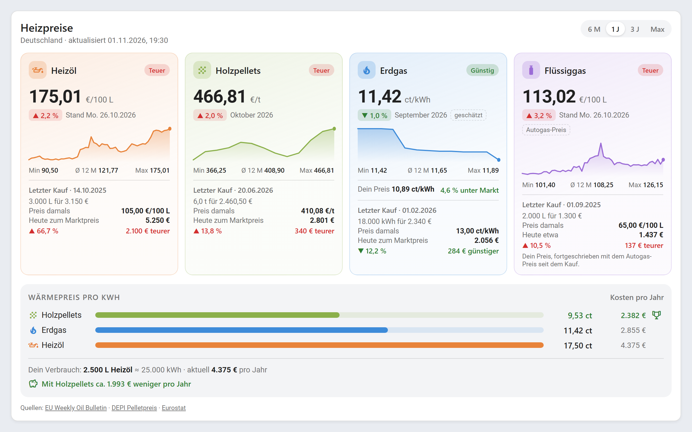

# Heating Prices – Heizöl, Pellets, Erdgas & Flüssiggas für Home Assistant

[](https://hacs.xyz/)
[](https://github.com/F30onAir/ha-heating-prices/actions/workflows/validate.yml)
[](https://github.com/F30onAir/ha-heating-prices/actions/workflows/tests.yml)

Aktuelle **Heizöl-, Pellet-, Erdgas- und Flüssiggaspreise** direkt in Home Assistant, mit einer
Dashboard-Karte, die Verlauf, Trend und den Wärmepreis pro kWh vergleicht.
Alle Daten stammen aus **offenen, amtlichen Quellen**. Es gibt kein Scraping von
Händlerseiten und es wird kein API-Schlüssel gebraucht.

*English below.*



*Echte Preise vom 01.11.2026. Eigener Preis, Verbrauch und Käufe sind Beispiele.*

## Funktionen

- **Heizöl** – wöchentlicher Durchschnittspreis inkl. aller Steuern für 27 EU-Länder,
  mit Verlauf seit 2005
- **Holzpellets** – monatlicher DEPI-Preis für Deutschland, bundesweit oder regional
  (Nord/Ost, Mitte, Süd) für 3, 6 oder 26 Tonnen
- **Erdgas** – Haushaltspreis von Eurostat für 27 EU-Länder, mit dem monatlichen
  Gaspreisindex auf den aktuellen Monat hochgerechnet
- **Flüssiggas** – amtlicher Autogas-Preis des EU Oil Bulletin für 19 EU-Länder, mit Verlauf.
  Kein Heizgas-Preis und deshalb nicht im Heizkostenvergleich ([warum?](#warum-nur-der-autogas-preis))
- **Preisbewertung** – günstig / normal / teuer im Vergleich zu den letzten 12 Monaten
- **Wärmepreis-Vergleich** – alle Brennstoffe in ct pro kWh Wärme und der aktuell günstigste
- **Eigener Preis** – trage ein, was du zahlst, und sieh die Abweichung zum Markt
- **Heizkosten-Rechner** – mit deinem Jahresverbrauch die Kosten pro Jahr für jeden
  Brennstoff und die mögliche Ersparnis
- **Letzter Kauf** – trage Datum, Menge und Gesamtpreis ein und sieh, was dieselbe Menge
  heute kostet
- **Kauf-Alarm** – fertiger Blueprint: Nachricht aufs Handy, wenn ein Brennstoff günstig wird
- **Dashboard-Karte** inklusive. Sie wird automatisch registriert, ohne manuelle Ressource
- Funktioniert auch bei Ausfällen: Der letzte Stand bleibt gespeichert und wird als „veraltet“ markiert

## Installation

### Über HACS (empfohlen)

[](https://my.home-assistant.io/redirect/hacs_repository/?owner=F30onAir&repository=ha-heating-prices&category=integration)

1. HACS öffnen → oben rechts **⋮ → Benutzerdefinierte Repositories**
2. `https://github.com/F30onAir/ha-heating-prices` mit Typ **Integration** hinzufügen
3. **Heating Prices** herunterladen und Home Assistant neu starten

### Manuell

Den Ordner `custom_components/heating_prices` nach `config/custom_components/` kopieren
und Home Assistant neu starten.

## Einrichtung

[](https://my.home-assistant.io/redirect/config_flow_start/?domain=heating_prices)

**Einstellungen → Geräte & Dienste → Integration hinzufügen → Heating Prices**

1. Land und Brennstoffe wählen
2. Bei Pellets: Region und Liefermenge
3. Bei Erdgas: Jahresverbrauch (Band D1, D2 oder D3)

Über **Konfigurieren** kannst du später Brennstoffe an- und abwählen, zum Beispiel
Flüssiggas ergänzen, und deine eigenen Preise, deinen Verbrauch und deinen letzten Kauf
eintragen.

## Heizkosten-Rechner

Trage unter **Konfigurieren** ein, womit du heizt und wie viel du pro Jahr verbrauchst:
Heizöl in Litern, Pellets in Tonnen, Erdgas in kWh. Die Integration rechnet das in deinen
Wärmebedarf um (10 kWh pro Liter Heizöl, 4,9 kWh pro kg Pellets) und zeigt für jeden
Brennstoff, was dieselbe Wärmemenge zu aktuellen Preisen pro Jahr kostet. Hast du einen
eigenen Preis eingetragen, nutzt sie ihn für deine aktuellen Kosten.

Beispiel: 2.500 L Heizöl ≈ 25.000 kWh → Heizöl 4.375 €, Pellets 2.382 €, Erdgas 2.855 € pro Jahr.

Der Vergleich betrifft nur die Brennstoffkosten. Wirkungsgrade, Wartung und
Anschaffungskosten einer neuen Heizung sind nicht berücksichtigt. Flüssiggas ist nicht
dabei, weil es dafür keinen amtlichen Heizgas-Preis gibt.

## Letzter Kauf

Trage unter **Konfigurieren** im letzten Schritt ein, wann du zuletzt wie viel gekauft und
was du insgesamt bezahlt hast: Heizöl und Flüssiggas in Litern, Pellets in Tonnen. Bei
Erdgas nimmst du Datum, Verbrauch und Betrag der letzten Abrechnung. Die Karte zeigt dann
deinen damaligen Preis, was dieselbe Menge heute kostet, und die Differenz.

Beispiel: 3.000 L Heizöl für 3.600 € sind 120,00 €/100 L. Bei heute 175,01 €/100 L kostet
dieselbe Menge 5.250 €, also 1.650 € mehr (+45,8 %).

Verglichen wird immer mit dem aktuellen amtlichen Preis, auch wenn du einen eigenen Preis
eingetragen hast. Er ist ein Durchschnitt, dein Angebot vor Ort kann abweichen.

Beim Flüssiggas wäre ein direkter Vergleich irreführend, weil der amtliche Preis für Autogas
gilt. Dort wird dein Preis mit der Entwicklung des Autogas-Preises seit dem Kauf
fortgeschrieben. Das Ergebnis ist eine Schätzung und auf der Karte so gekennzeichnet.

## Sensoren

Für jeden Brennstoff entsteht ein Gerät mit diesen Sensoren:

| Sensor | Beispiel | Beschreibung |
|---|---|---|
| Preis | `175,01 €/100 L` | Aktueller Preis, Attribute mit Min/Max/Ø über 12 Monate |
| Preis pro kWh Wärme | `17,50 ct/kWh` | Für den Vergleich zwischen den Brennstoffen, nicht bei Flüssiggas |
| Veränderung | `2,2 %` | Gegenüber der Vorwoche bzw. dem Vormonat |
| Preisbewertung | `Teuer` | Günstig / Normal / Teuer im Vergleich zu 12 Monaten |
| Kosten pro Jahr | `4.375 €` | Nur mit Heizkosten-Rechner, nicht bei Flüssiggas |
| Differenz zum letzten Kauf | `1.650 €` | Nur mit eingetragenem Kauf: was dieselbe Menge heute mehr oder weniger kostet |
| Veränderung seit letztem Kauf | `45,8 %` | Nur mit eingetragenem Kauf |

Bei mehreren Brennstoffen im Vergleich kommt das Gerät **Heizkostenvergleich** dazu, mit
**Günstigster Brennstoff** und, mit Heizkosten-Rechner, **Meine Kosten pro Jahr** und
**Mögliche Ersparnis pro Jahr**.

## Dashboard-Karte

Die Karte steht nach der Installation in der Kartenauswahl als **Heating Prices** bereit.
Alternativ in YAML:

```yaml
type: custom:heating-prices-card
# alle Angaben sind optional
title: Heizpreise
fuels: [heating_oil, pellets, natural_gas, lpg]
range: 1y            # 6m, 1y, 3y oder max
show_comparison: true
entry_id: ...        # nur nötig, wenn mehrere Länder eingerichtet sind
```

## Kauf-Alarm (Blueprint)

[](https://my.home-assistant.io/redirect/blueprint_import/?blueprint_url=https%3A%2F%2Fgithub.com%2FF30onAir%2Fha-heating-prices%2Fblob%2Fmain%2Fblueprints%2Fautomation%2Fheating_prices%2Fprice_alert.yaml)

Der Blueprint schickt eine Nachricht, sobald ein Brennstoff im Vergleich zu den letzten
12 Monaten **günstig** wird (auf Wunsch auch bei **teuer**). Nach dem Import unter
**Einstellungen → Automationen → Blueprints → Heating Prices – Kauf-Alarm** wählst du:

1. den Sensor **Preisbewertung** des Brennstoffs, z. B. `sensor.heizol_preisbewertung`
2. die Empfänger, z. B. deine Companion-App
3. optional eigene Texte und weitere Aktionen, z. B. eine Durchsage

Beispielnachricht: *„Heizöl: Günstig – Heizöl kostet jetzt 159,90 €/100 L (günstig im
Vergleich zu den letzten 12 Monaten).“*

## Datenquellen

| Brennstoff | Quelle | Aktualisierung | Lizenz |
|---|---|---|---|
| Heizöl | [EU Weekly Oil Bulletin](https://energy.ec.europa.eu/data-and-analysis/weekly-oil-bulletin_en) (Europäische Kommission) | wöchentlich | Wiedergabe mit Quellenangabe erlaubt |
| Holzpellets | [DEPI-Pelletpreis](https://www.depi.de/pelletpreis-wirtschaftlichkeit/) (Deutsches Pelletinstitut) | monatlich | Honorarfrei mit Quellenangabe |
| Erdgas | [Eurostat nrg_pc_202 und prc_hicp_minr](https://ec.europa.eu/eurostat/databrowser/view/nrg_pc_202/default/table) | halbjährlich und Index monatlich | CC BY 4.0 |
| Flüssiggas (Autogas) | [EU Weekly Oil Bulletin](https://energy.ec.europa.eu/data-and-analysis/weekly-oil-bulletin_en) (Europäische Kommission) | wöchentlich | Wiedergabe mit Quellenangabe erlaubt |

Die Integration fragt die Quellen alle 6 Stunden ab. Die große Historie des Oil Bulletin
(ca. 4,5 MB) wird höchstens einmal im Monat geladen.

**Warum keine tagesaktuellen Händlerpreise?** Portale wie HeizOel24 oder HeizPellets24
verbieten in ihren AGB den automatisierten Abruf. Diese Integration nutzt deshalb nur
Quellen, deren Daten ausdrücklich weiterverwendet werden dürfen.

**Warum ist der Gaspreis „geschätzt“?** Eurostat veröffentlicht Haushaltsgaspreise nur
halbjährlich. Der letzte amtliche Wert wird mit dem monatlichen Gaspreisindex
(HVPI) fortgeschrieben. Der amtliche Wert steht im Attribut `official_price`.

### Warum nur der Autogas-Preis?

Für Flüssiggas zum Heizen gibt es keinen amtlichen Eurobetrag, sondern nur Händlerpreise.
Das EU Oil Bulletin nennt den Preis für Flüssiggas als Kraftstoff. Heizgas wird anders
besteuert und meist im Tank geliefert, dein Preis kann also deutlich abweichen, nach oben
wie nach unten. Deshalb trägt der Wert auf der Karte den Hinweis „Autogas-Preis“, zeigt
keinen Wärmepreis und zählt nicht beim günstigsten Brennstoff oder im Heizkosten-Rechner.
Der Verlauf taugt trotzdem als Hinweis auf die Marktentwicklung.

Für Österreich, Dänemark, Finnland, Griechenland, Irland, Malta, Schweden und Zypern
veröffentlicht das Oil Bulletin keinen Wert.

**Wärmepreis:** Umrechnung mit 10 kWh pro Liter Heizöl und 4,9 kWh pro kg Pellets
(Heizwert). Wirkungsgrade der Heizung sind nicht berücksichtigt.

## Haftungsausschluss

Alle Angaben ohne Gewähr. Die Preise sind Durchschnittswerte, dein Angebot vor Ort kann
abweichen. Dieses Projekt steht in keiner Verbindung zu den genannten Datenquellen.

---

## English

**Heating Prices** brings heating oil, wood pellet, natural gas and LPG prices into
Home Assistant, using open data only:

- **Heating oil**: weekly consumer prices incl. taxes for 27 EU countries (EU Weekly Oil Bulletin), history back to 2005
- **Wood pellets**: monthly DEPI price for Germany, nationwide or by region
- **Natural gas**: Eurostat household price for 27 EU countries, carried forward with the monthly gas price index (marked as an estimate)
- **LPG**: official EU Oil Bulletin price of LPG as a motor fuel (Autogas) for 19 EU countries. LPG for heating is taxed differently and has no official price, so this value is labelled as a motor fuel price and stays out of the per-kWh comparison and the cost calculator. Enable it under *Configure*.

Each fuel gets sensors for price, price per kWh of heat, change and a 12-month price
rating (low/normal/high). A dashboard card (`custom:heating-prices-card`) is registered
automatically. It shows trends, sparklines, a per-kWh comparison and your own price
compared with the market.

Enter the fuel you heat with and your yearly consumption in the options to get the
yearly cost of every fuel for your heat demand and the potential savings. The
[price alert blueprint](blueprints/automation/heating_prices/price_alert.yaml) sends a
notification when a fuel becomes cheap compared with the last 12 months.

You can also enter your last purchase of each fuel (date, amount, total price) to see what
the same amount costs today at the official price. For natural gas, use your last bill. For
LPG, your price is carried forward with the motor fuel price trend since the purchase, so
the result is an estimate.

Install through HACS as a custom repository (category *Integration*), restart, then add
**Heating Prices** under *Settings → Devices & services*. The UI is available in English
and German.

## License

Code: [MIT](LICENSE). Price data belongs to the respective sources, see [NOTICE.md](NOTICE.md).
